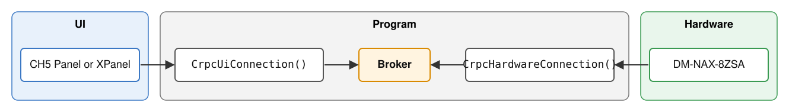
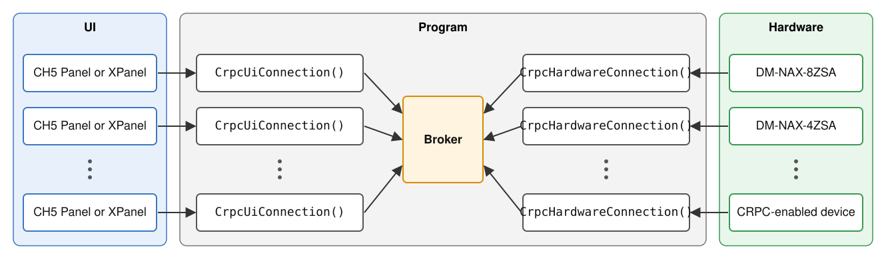

# Section Outline: Connecting CH5 Media Players to NAX with CRPC

|||
|----:|----|
| **Length:** | 30 minutes (core content fills the slot; no buffer. "Time permitting" items add about 3 min, so skip them if you're behind.) |
| **Audience:** | C# programmers with minimal/intermediate experience (Crestron background expected) |
| **Companion handout:** | `CRPC-Connections-HowTo.md` (also HTML and PDF) |
| **Goal:** | Attendees leave able to (1) add a panel, (2) add a hardware player, and (3) use the log to tell which side is misconfigured. |
|||

---

## Before class

- [ ] Processor loaded with the current build, NAX online, two panels (0x03, 0x04) open side by side.
- [ ] Log page (CwsDebug) open on the projector, filtered to Notice and above.
- [ ] Disable Copilot code completions in Visual Studio.
- [ ] Visual Studio open with five tabs: `ControlSystem.cs` (`SetupNaxSources`), `MediaPlayerId.cs`, `HardwareSetup.cs` (CRPC section), `UI.cs` (Media Player section), `CrpcHardwareConnection.cs` (`for` loop comment).
- [ ] SIMPL Windows program open (Media Player extender & NAX Player) and the DM-NAX-8ZSA Player Transport Control help page loaded.
- [ ] LINQPad open with the `Record Equality Demo` and `Lambda Removal Demo`.
- [ ] Handout printed or shared.
- [ ] Backup: video of using the CH5 Media Player and screenshots of the log for each demo step, in case the hardware misbehaves.

---

## Timeline at a glance

| Time | Min | Segment | Format |
|---|---|---|---|
| 0:00–0:03 | 3 | 0. Introduction | Live demo + SIMPL |
| 0:03–0:05 | 2 | 1. What are we doing? | Talk + discussion |
| 0:05–0:08 | 3 | 2. Challenges | Discussion |
| 0:08–0:10 | 2 | 3. `MediaPlayerId`: the address | Code (+2 min LINQPad, time permitting) |
| 0:10–0:12 | 2 | 4. Communication flow | Diagram |
| 0:12–0:15 | 3 | 5. Hardware side: `CrpcHardwareConnection` | Code |
| 0:15–0:22 | 7 | 6. UI side: `CrpcUiConnection` | Code + live demo |
| 0:22–0:26 | 4 | 7. Three C# ideas that make it work | Talk + code + LINQPad (+1 min `for` loop, optional) |
| 0:26–0:28 | 2 | 8. Troubleshooting with the log | Live demo |
| 0:28–0:30 | 2 | 9. Recap and questions | Talk |

---

## 0. Introduction (0:00–0:03)

Now that you've seen how to select NAX audio sources and tie button event handlers into the generated contracts, let's look at adding the Media Players.

**Note:**
I will sometimes use "streaming player" as shorthand for a single media player on NAX or other hardware that supports media playback.

**DEMO 1:** First, let's see one in action.  (live or video)
  - Show an XPanel with the CH5 Media Player active.  
  - Navigate through the available sources; play/pause the stream.

**DEMO 2:**
  * Show SIMPL Windows - Media Player extender & NAX Player - focus on `CRPC`, `CRPC_FB`, & `Message_Fb`.
  * Show DM-NAX-8ZSA Player Transport Control help: https://help.crestron.com/simpl/#ACards_DM/DM-NAX/DM-NAX-8ZSA/Player%20Transport%20Control.htm

---

## 1. What are we doing? (0:03–0:05)

**Key points**
- The CH5 Media Player on the panel and the players in the NAX don't talk to each other directly. Our program passes messages between them.
- The messages are **CRPC** strings, which are simply JSON formatted data that go back and forth. We don't need to read or understand them. We just deliver them to the right place.
- Three jobs: commands **in**, feedback **out**, tell the panel's media player **the source changed**.

**Say:** "Fortunately, you don't have to understand CRPC.  Your job is to be a good telephone switchboard operator-- ask who are you trying to reach, then plug the cable in.  When the call completes, you unplug the cable."

**Check for engagement:**
- "If you only needed to route the `CRPC` & `CRPC_FB` signals in SIMPL, how would you do that?"
- "Thinking about what we've done so far, what can we use to route these signals between the `NaxAmp` and `XpanelForHtml5` without directly connecting them?"  (*Using the `Broker` class.*)
- "Does the Broker need to know what type of touchpanel or NAX hardware we are using?"  (*It does not.  This also means the two pieces of hardware don't need to know anything about each other.*)

---

## 2. Challenges (0:05–0:08)

**Challenge 1**
- When using the Broker, we need to use a consistent set of keys, preferably without using "magic strings".  The Broker only listens for keys that have an **exact match**.  We'll use a class to help us keep things consistent.

**Ask:**  
  - "Have we removed any delegates from the Broker so far?"  (*No.*)
  - "After adding a delegate to the Broker, how long is it active?"  (*As long as the program is running.*)
  - "When do the players on the hardware need to listen for commands from the UI?"  (*Always.*)
  - "When do the CH5 Media Players need feedback from the streaming players?"  (*Only when needed, and only from one player at a time.*)

**Challenge 2**
- This means we need to dynamically add and remove delegates on the UI side.  This can be a challenge when using lambdas.  **Remember that, as we'll come back to it.**  Our classes handle the UI and Hardware Broker subscriptions.

**Challenge 3**
- We need to let the CH5 Media Player know when the source has changed.  Without it, it will never know to start communicating with the streaming player.  The message that does that isn't documented, so we put it into our class.

**Challenge 4**
- We need to implement some classes in a way that supports multiple touchpanels and multiple pieces of streaming hardware, and we can mix and match them.

---

_Now let's look at the class implementation.  You've already been introduced to the Broker, so let's look at how we keep the Broker keys straight._

## 3. `MediaPlayerId`: the address (0:08–0:10)

**ON SCREEN:** `ControlSystem.SetupNaxSources()`

**Key points**
- We identify each streaming player with two pieces of information: the hardware ID and the specific player number.
- We could have used a single string, but each player needs **two** broker keys, `CommandKey` and `FeedbackKey`, for two independent subscriptions: the hardware always listens on one, and the UI listens on the other only while connected. Building both by hand everywhere brings back magic strings. 
- Keeping the hardware ID and player number separate also lets the hardware side build the matching ID from just a player number.
- This builds **both broker keys** for you.   

**ON SCREEN:** The `MediaPlayerId` class.

**Key points**
- Show `CommandKey` and `FeedbackKey`.  Never type those strings by hand.
- It's a `record`, so two IDs with the same values are equal.  (We'll use this in a minute.)
- A blank hardware ID crashes at startup **on purpose**.  Fail loudly early rather than quietly later.

**Time Permitting**: Show the `Record Equality Demo` in LINQPad.  If time is short, suggest they read through the class comments, particularly if they have never used a record before.

**Should it come up**
- We made this a `sealed` record because it should not be inherited or overridden.

---

_Now, let's look at how we use the Crpc-related classes._

## 4. Communication flow (0:10–0:12)

**Key points**
- We use one instance of the classes per device / per IP ID.
- We use one `CrpcHardwareConnection` **per** streaming server, like the NAX-8ZSA.
- **Hardware side:** subscribes at startup and never lets go. It's always listening.
- We use one `CrpcUiConnection` **per** panel.
- **UI side:** subscribes only while the user is looking at a player. It switches when the user switches players. It disconnects when the user closes the media player.
- Two panels on the same player both get the feedback. That's intended and matches SIMPL.

**Check for understanding:** "If I add a panel, which side of the diagram gets a new box?" (*The UI side. One new `CrpcUiConnection`.*)

---

## 5. Hardware side: `CrpcHardwareConnection` (0:12–0:15)

**Key points**
- This class ensures each player on the hardware subscribes to CRPC commands from the UI and provides a way to get feedback to the UI. 
- Uses unique `CommandKey`s and allows us to assign a callback to pass the CRPC message to the specific player.  This is **always listening** for messages.
- The `CommandKey` includes both the `hardwareId` & `playerNumber`.
- Provides a method, `SendFeedback`, that our hardware wrapper uses to publish CRPC feedback from the players so any connected CH5 Media Player gets it.  It always publishes. If no UI is listening, the broker drops the message, and that's normal.

**ON SCREEN:** `HardwareSetup.cs`, the Media Player CRPC block.

**Walk through the two steps:**
1. **Create it:** hardware ID, player count, and a lambda that says *how* to send to the NAX.
2. **Feed it:** the NAX's `CrpcMessageReceived` event calls `SendFeedback`.

**Key points**
- The class doesn't know what a NAX is. The lambda teaches it. → Another brand of player can use the same class.
- One per device. A duplicate ID (even `nax1` vs `Nax1`) throws at startup.
- The hardware ID **must match** the ID in your `MediaPlayerId`s. This is the #1 setup mistake.

**Check for understanding:** 
- "If you only have a four zone NAX, what would you need to change in `CrpcHardwareConnection`?"  (*Nothing in the class.  Pass a different `playerCount` when you create it in `HardwareSetup`.*)

**Show briefly:** How-To §4.4, "Adding a second NAX." It's three statements in `HardwareSetup` plus its `AddSource` lines, and `UI.cs` doesn't change.

---

## 6. UI side: `CrpcUiConnection` (0:15–0:22)

**Key points**
- This class dynamically subscribes and unsubscribes to the selected streaming player, so it only listens to CRPC feedback when needed.
- Uses the `FeedbackKey` to assign a callback for a particular player to send CRPC FB to the CH5 Media Player.
- Provides a method, `SendCommand`, to send CRPC messages to the selected streaming player.
- The class lets the CH5 Media Player know when the source has changed.  This tells it to restart communication with a new player.
- Forces a delay when closing the CH5 Media Player to ensure it receives and processes the "source 0" message.  This is a work-around for the media player not always syncing up with new sources when using a hard-coded page flip.

**Show:** `UI.cs`, the constructor where `CrpcUiConnection` is created with two lambdas (Message_FB and CRPC_FB).

**Walk through the five call sites** (How-To §5.3). Keep each to about 30 seconds:
1. CRPC event → `SendCommand`
2. Source select (player) → show page, then `Connect`
3. Source select (not a player) → `_ = DisconnectAsync()`
4. Return button → `await DisconnectAsync()`, **then** flip the page
5. Panel offline → `_ = DisconnectAsync()`

**Live demo (about 3 min, leaving about 1 min for the checks below)**
1. Panel A: select Media Player 1. In the log, point out the source-change message (`tag` 01) and "connected to …CrpcFb".
2. Panel B: select Media Player 1. Point out `tag` 02. Press Play on B, and **both panels update.**
3. Panel B: press Return.  Select Media Player 2. Point out `tag` 02. Navigate the UI and show independent operation.
4. Clear the log.
5. Panel A: press Return.  In the log, point out "returning from the Media Player page" and "is unsubscribing from Media Player …CrpcFb." (The `src 0` message is sent but `DisconnectAsync` doesn't log it, so it won't appear.)

**Key point, the one rule to remember:** *Don't flip away from the Media Player page directly. Await `DisconnectAsync` first.* The panel needs about 200 ms with the page still open to process the "source 0" message. Otherwise the next connection can fail.

**Check for understanding:** 
- "What does a new panel class need to change in `CrpcUiConnection`?" (*Nothing. Create one and wire up the five call sites.*)
- How many instances of `CrpcUiConnection` would we have with two touchpanels and two Xpanels?  (*Four.  PSA: Don't re-use IP IDs.*)

---

## 7. Three C# ideas that make it work (0:22–0:26)

Pick these three. The rest are in the handout (How-To §9).

**a. Callbacks (named delegates), about 1.5 min**
- "Here's a method; call it when you need to send."  That's all a delegate is.  We give each callback a name (`SendCrpcToHardware`, `SendMessageFbToUi`, `SendCrpcFbToUi`) so IntelliSense shows what the arguments mean.
- That's why neither class mentions `NaxAmp` or the Construct contract.

**b. Lambda vs. named method, about 1.5 min**

**Ask:** "Can I get a show of hands for anyone that uses lambda expressions regularly?"

**Show** the `Lambda Removal Demo` in LINQPad.

- Hardware side uses a lambda because it never unsubscribes.
- UI side uses the named method `ForwardCrpcFbToUi` because to **remove** a subscription, you must hand the broker the **same** method you added.  Each lambda you write creates a new delegate, so you need to keep a reference to the one you added.  If we used lambdas for the `Add` and `Remove` calls, we will effectively resubscribe and never unsubscribe because the delegates are not the same object.  If you see multiple responses when using the Broker dynamically, this may be why.
- *Optional, if the room is with you:* show the `for`-loop capture comment in `CrpcHardwareConnection`.  It's a classic bug and worth knowing exists.

**c. `async` / `await`, about 1 min**
- `await Task.Delay(200)` waits without freezing the panel. `Thread.Sleep` freezes it.
- `async void` is **only** for event handlers. Everywhere else, use `async Task`.
- `_ = DisconnectAsync();` means "start it, don't wait."  Use it when nothing has to happen afterward.

---

## 8. Troubleshooting with the log (0:26–0:28)

**Live demo (pre-staged, or show screenshots):** change one source's `MediaPlayerId` to `"Nax2"` (no such hardware), select it, and press Play.

**Point out:** *"UI instance 1: no hardware is listening for Nax2.Player1. Check that its HardwareId and PlayerNumber match…"*

**Key point:** The log tells you **which side** is wrong. Show How-To §8 (Troubleshooting table) and tell them it's the first place to look.

---

## 9. Recap and questions (0:28–0:30)

**Three takeaways (say them, then leave them on screen):**

1. **One `CrpcHardwareConnection` per device, one `CrpcUiConnection` per panel.** They meet only at the broker.
2. **`MediaPlayerId` is the address.** The hardware ID must match on both sides, and you never type broker keys by hand.
3. **`await DisconnectAsync()` before leaving the Media Player page.**

**Likely questions, with short answers**

| Question | Answer |
|---|---|
| "Why do both panels get the feedback?" | They're watching the same player. That's intended and matches SIMPL. |
| "What's `src`, and where does it come from?" | The Media Player's source number. `NaxSourceConfiguration` hands them out (1, 2, 3…) in the order players are added. 0 means none. Don't hard-code them. |
| "What's the `tag`?" | Each panel's `CrpcUiConnection` instance number, assigned in the order panels are created. You don't set it. |
| "Can I use this with a non-Crestron player?" | Yes. Pass a callback that sends to that device, and call `SendFeedback` from its feedback event. If it numbers players from 0, translate in the callback. |
| "Why 200 ms?" | It was found by testing. It's long enough for the panel to process the source change. We don't break the "100ms Rule" for instantaneous feedback because the button feedback changes immediately. |
| "Why not just make one big class?" | Don't make classes bigger than necessary. The hardware lives as long as the program; panel connections come and go. Different lifetimes, different classes. |

---

## Optional take-home exercise (if you want to extend past 30 min)

1. Add a third panel at IP ID `0x05`. Confirm in the log that it gets `tag` 03.
2. Add "Media Player 3" (`new MediaPlayerId("Nax1", 3)`) to zones 1 and 2. Confirm that it gets its own `src` number and that both panels can control it.
3. Break it on purpose: change `"Nax1"` to `"nax1"` in one `MediaPlayerId`. Predict the log message before you run it. (*Hint: the broker keys are case-sensitive, even though the duplicate-ID check isn't.*)
4. Add logic to the `UI` class to trigger DisconnectAsync() whenever a program stopping event is raised.