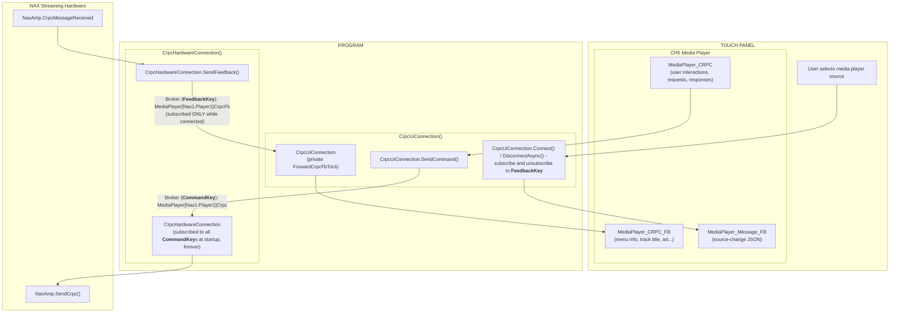

# How To Use `CrpcHardwareConnection` and `CrpcUiConnection`

**Project:** Masters2026Nax
**Code:** `Masters2026Nax/Crpc/CrpcHardwareConnection.cs`, `Masters2026Nax/Crpc/CrpcUiConnection.cs`
**Related:** `Configuration/MediaPlayerId.cs`, `Configuration/NaxSourceConfiguration.cs`, `Hardware/HardwareSetup.cs`, `UI/UI.cs`
**Written against commit:** `ce3635a`

---

## 1. What these classes are for

The CH5 **Media Player** object on a touch panel does not talk to the NAX streaming media players directly.
Your program sits in the middle and has to do three things:

1. Tell the panel's Media Player **the source has changed and to start talking to the new source** (the "source-change message").
2. Pass **CRPC commands** from the panel's Media Player to the right hardware player.
3. Pass **CRPC feedback** from that hardware player back to every panel that's watching it.

Two classes split this work. Each one handles one end of the conversation:

| Class | Where you create it | How many | What it does |
|---|---|---|---|
| `CrpcHardwareConnection` | `HardwareSetup` | **One per media server** (one per device with one or more streaming media players, e.g. _DM-NAX-8ZSA_) | Listens for commands for each of the hardware's players and publishes their feedback |
| `CrpcUiConnection` | `UI` | **One per panel** that has a CH5 Media Player object | Connects the panel to one player at a time, forwards commands, receives feedback, sends source-change messages |

The two classes **never reference each other.** They only share the Message Broker
keys, and those keys come from `MediaPlayerId`.

---

## 2. Communication flow



Three things to remember:

- **The hardware side is always listening.** `CrpcHardwareConnection` subscribes to every
  player's command key in its constructor and never unsubscribes.
- **The UI side subscribes only while connected to a player.** `CrpcUiConnection` subscribes to one player's
  feedback key when you call `Connect`. It unsubscribes when you connect to a different player or
  call `DisconnectAsync`.
- **Every panel connected to the same player receives the same feedback.** This is intentional
  and matches how SIMPL implementations behave.

---

## 3. `MediaPlayerId`: the address of a player

Every hardware media player is identified by a `MediaPlayerId`. It has two parts:

```csharp
var player = new MediaPlayerId("Nax1", 1);   // Player 1 on the hardware called "Nax1"
```

| Member | Example value | Used by |
|---|---|---|
| `HardwareId` | `"Nax1"` | Must match the hardware ID given to `CrpcHardwareConnection` |
| `PlayerNumber` | `1` | Which player on that hardware |
| `CommandKey` | `"MediaPlayer[Nax1.Player1]Crpc"` | UI **sends** to this key; hardware **listens** to this key |
| `FeedbackKey` | `"MediaPlayer[Nax1.Player1]CrpcFb"` | Hardware **sends** to this key; UI **listens** to this key |
| `ToString()` | `"Nax1.Player1"` | Log messages, and the player name shown on the panel |

Why it matters to you:

- **Never type a broker key string by hand.** Always ask the `MediaPlayerId` for `CommandKey` or
  `FeedbackKey`. A typo in a hand-typed key fails silently.
- **It's a `record`,** so two `MediaPlayerId` objects with the same `HardwareId` and `PlayerNumber`
  are equal (`==` returns `true`). `CrpcUiConnection` uses this to tell whether you're reconnecting
  to the player you're already on.
- **A blank `HardwareId` throws `ArgumentException` at startup.** That's on purpose: it's better to
  fail quickly and loudly than to have CRPC quietly go nowhere later.

You give each media-player source its `MediaPlayerId` in `ControlSystem.SetupNaxSources()`:

```csharp
NaxSourceConfiguration.AddSource(zone1, "Media Player 1", 9, "", new MediaPlayerId("Nax1", 1));
```

---

## 4. Hardware side: `CrpcHardwareConnection`

### 4.1 Create one per media server

In `HardwareSetup`, after you create the hardware wrapper:

```csharp
myNaxamp = new NaxAmp(0x10, naxHardwareId, cs);

ushort naxPlayerCount = 8;
myCrpcHardwareConnection = new CrpcHardwareConnection(
    myNaxamp.HardwareId,          // 1. Unique name for this hardware, e.g. "Nax1"
    naxPlayerCount,               // 2. How many players it has
    (player, msg) =>              // 3. How to send a CRPC command to the real hardware
    {
        myNaxamp.SendCrpc(player, msg);
    });
```

| Parameter | Type | What to pass |
|---|---|---|
| `hardwareId` | `string` | The same ID used in every `MediaPlayerId` for this hardware. **Must be unique**, and the check ignores case. |
| `playerCount` | `ushort` | Number of players. CommandKeys are registered for players `1` through `playerCount`. |
| `sendCrpcToHardware` | `CrpcHardwareConnection.SendCrpcToHardware` | A method or lambda that takes `(playerNumber, crpcPayload)` and sends it to the device. |

The class doesn't know what a `NaxAmp` is. You tell it how to talk to the hardware through the
callback. That's why the same class can work with a different brand of player later.

#### Writing the callback

`SendCrpcToHardware` is a named delegate declared inside `CrpcHardwareConnection`:

```csharp
public delegate void SendCrpcToHardware(ushort playerNumber, string crpcPayload);
```

| Argument | Meaning |
|---|---|
| `playerNumber` | **1-based** player number on this hardware (1 through `playerCount`). |
| `crpcPayload` | The serialized CRPC message from the panel. Forward it unchanged. |

To write the lambda: hover over the constructor's third parameter in Visual Studio (or press
`Ctrl+Shift+Space` while typing the call) to see the delegate's signature and docs. Your lambda
needs to take those two arguments and hand them to whatever method on your device class sends CRPC.
The parameter names in your lambda are up to you, but matching the delegate's names (`playerNumber`,
`crpcPayload`) keeps the code easy to compare with the docs.

```csharp
(playerNumber, crpcPayload) =>
{
    myNaxamp.SendCrpc(playerNumber, crpcPayload);
}
```

The same shape works as an expression-bodied lambda or a named method:

```csharp
// Expression-bodied lambda
(playerNumber, crpcPayload) => myNaxamp.SendCrpc(playerNumber, crpcPayload)

// Named method (method group), if the signature matches exactly
private void SendToNax(ushort playerNumber, string crpcPayload) =>
    myNaxamp.SendCrpc(playerNumber, crpcPayload);
// ...
new CrpcHardwareConnection(myNaxamp.HardwareId, 8, SendToNax);
```

The callback runs on the thread that delivers the UI's message, so keep it short and don't block.

### 4.2 Feed it the hardware's feedback

Hook the device's CRPC feedback event to `SendFeedback`.

```csharp
myNaxamp.CrpcMessageReceived += (sender, e) =>
{
    myCrpcHardwareConnection.SendFeedback((ushort)e.Player, e.CRPCMessage);
};
```

`SendFeedback(playerNumber, crpcPayload)` puts the payload on that player's `FeedbackKey`.
If no panel is connected to the player, the message is simply dropped. That's normal and is not logged.

### 4.3 Rules for the hardware side

- **One instance per piece of hardware, for the life of the program.** A second instance with the
  same `hardwareId` (including `"nax1"` vs `"Nax1"`) throws `ArgumentException` at startup.
- **The `hardwareId` must exactly match the `HardwareId` in your `MediaPlayerId` configuration.**
  If they don't match, the UI's commands go to a key nobody is listening on (see Troubleshooting).
- **Players are registered starting at 1.** If you add a device whose players are numbered from 0,
  translate in your callback (for example, `(player, msg) => device.Send(player - 1, msg)`), and
  translate back when you call `SendFeedback`.
- **Never unsubscribe to CommandKeys.** The hardware should always be ready for commands from the UI.

### 4.4 Example: adding a second NAX

```csharp
// In HardwareSetup.  Use an IP ID that isn't already in use.
myNaxamp2 = new NaxAmp(0x12, "Nax2", cs);

myCrpcHardwareConnection2 = new CrpcHardwareConnection(
    myNaxamp2.HardwareId,
    8,
    (player, msg) => myNaxamp2.SendCrpc(player, msg));

myNaxamp2.CrpcMessageReceived += (sender, e) =>
    myCrpcHardwareConnection2.SendFeedback((ushort)e.Player, e.CRPCMessage);
```

Then add its players as sources in `ControlSystem.SetupNaxSources()`:

```csharp
NaxSourceConfiguration.AddSource(zone1, "Media Player B2", 10, "", new MediaPlayerId("Nax2", 1));
```

You don't need to change anything in `UI` or `CrpcUiConnection`.

---

## 5. UI side: `CrpcUiConnection`

### 5.1 Create one per panel

In the `UI` constructor:

```csharp
myCrpcMediaPlayerConnection = new CrpcUiConnection(
    message => myContract.MediaControl.MediaPlayer.MediaPlayer_Message_FB(message),  // source-change messages
    crpc    => myContract.MediaControl.MediaPlayer.MediaPlayer_CRPC_FB(crpc));       // CRPC feedback
```

| Parameter | Type | What to pass |
|---|---|---|
| `sendMessageFbToUi` | `CrpcUiConnection.SendMessageFbToUi` | Sends a string to the Media Player's **Message_FB** input |
| `sendCrpcFbToUi` | `CrpcUiConnection.SendCrpcFbToUi` | Sends a string to the Media Player's **CRPC_FB** input |

The class doesn't need to reference the Construct contract. It only calls the two callbacks you give it, 
which keeps the generated contract types out of the CRPC code.

#### Writing the callbacks

Both are named delegates declared inside `CrpcUiConnection`, each taking a single string:

```csharp
public delegate void SendMessageFbToUi(string message);      // source-change message (JSON)
public delegate void SendCrpcFbToUi(string crpcPayload);     // CRPC feedback from the hardware player
```

Each lambda's only job is to write that string, unchanged, to the matching Media Player input in
your panel's generated contract. In this project that's:

```csharp
message => myContract.MediaControl.MediaPlayer.MediaPlayer_Message_FB(message)
crpc    => myContract.MediaControl.MediaPlayer.MediaPlayer_CRPC_FB(crpc)
```

The two are easy to swap by accident, and the compiler can't tell because both take a `string`.
**The first parameter is always the source-change channel (`Message_FB`); the second is always the
CRPC channel (`CRPC_FB`).** If the Media Player never connects, check the order first.

If your panel's contract names the Media Player differently (for example a second Media Player
object, or a different contract path), only these lambdas change. `CrpcUiConnection` stays the same.

Each instance assigns itself an instance ID (1, 2, 3…) in the order the panels are created. The
Media Player uses that ID as the `tag` in the source-change message. You don't set it yourself.

### 5.2 The public API: three methods

| Method | Call it when… | What it does |
|---|---|---|
| `Connect(MediaPlayerId?)` | The user picks a source that is a media player | Sends the source-change message, then subscribes to that player's feedback |
| `SendCommand(string)` | The panel's Media Player sends CRPC | Forwards the CRPC to the connected player |
| `DisconnectAsync()` | The user leaves the player, picks a non-player source, or the panel goes offline | Sends "source 0", waits 200 ms, then unsubscribes |

Every `Connect` should eventually be matched by a `DisconnectAsync`.

### 5.3 Where to call each method

There are **five** call sites in `UI.cs`. A new panel class needs the same five.

**1. Panel sends CRPC → `SendCommand`**

```csharp
myContract.MediaControl.MediaPlayer.MediaPlayer_CRPCEvent += MediaPlayer_MediaPlayer_CRPCEvent;

private void MediaPlayer_MediaPlayer_CRPCEvent(object sender, UIEventArgs e)
{
    myCrpcMediaPlayerConnection.SendCommand(e.SigArgs.Sig.StringValue);
}
```

**2. User selects a media-player source → show the page, then `Connect`**

```csharp
if (NaxSourceConfiguration.IsMediaPlayer(zone, buttonIndex))
{
    myContract.MediaControl.VisibilityJoin(true);    // show the Media Player page first
    myContract.MediaControl.VisibilityJoin(false);

    var mediaPlayer = NaxSourceConfiguration.GetMediaPlayer(zone, buttonIndex);
    myCrpcMediaPlayerConnection.Connect(mediaPlayer);

    myContract.MediaControl.MediaPlayer.MediaPlayer_Offline(false);
    myContract.MediaControl.MediaPlayer.MediaPlayer_Player_Name(mediaPlayer.ToString());
}
```

**3. User selects a source that is *not* a media player → `DisconnectAsync` (fire and forget)**

```csharp
else
{
    _ = myCrpcMediaPlayerConnection.DisconnectAsync();
}
```

**4. User presses Return on the Media Player page → `await DisconnectAsync`, *then* flip the page**

```csharp
private async void MediaControl_ReturnBtn_PressEvent(object sender, UIEventArgs e)
{
    if (e.SigArgs.Sig.BoolValue)
    {
        await myCrpcMediaPlayerConnection.DisconnectAsync();   // waits ~200 ms

        myContract.Main.VisibilityJoin(true);                  // now leave the page
        myContract.Main.VisibilityJoin(false);
    }
}
```

**5. Panel goes offline → `DisconnectAsync`**

```csharp
else   // !args.DeviceOnLine
{
    _ = myCrpcMediaPlayerConnection.DisconnectAsync();
}
```

### 5.4 What `Connect` does, step by step

1. Looks up the player's `src` number from `NaxSourceConfiguration` (or uses `0` if you pass `null`), 
   which is used in the following step.
2. Builds the source-change JSON, for example `{"ver":"4.0.0","tag":"01","src":"3"}`, and sends it
   through `sendMessageFbToUi`.
3. If the player is the one you're already connected to, it stops here. There's no unsubscribe/resubscribe.
4. Otherwise it unsubscribes from the old player's feedback, remembers the new player, and subscribes
   to the new player's `FeedbackKey`.

Passing `null` sends `src 0` and leaves the panel unsubscribed.

### 5.5 What `DisconnectAsync` does, step by step

1. If nothing is connected, it logs and returns.
2. Sends the source-change message with `src 0` while the Media Player page is still open.
3. Waits 200 ms (`Task.Delay`) so the panel's Media Player can process it. 200 ms was found by testing.
4. If the panel is still connected to the same player, it unsubscribes.
5. It **never throws.** Any exception is caught and logged.

### 5.6 Why you can't just flip the page

If the Media Player page closes before the panel processes the "src 0" message, the panel's player
can end up in the wrong state. Then it may not connect properly the next time, especially to a
different player. That's why the Return button **awaits** `DisconnectAsync` before the page flip,
instead of using a hard-coded page flip in Construct.

A future update to the CH5 Media Player may eliminate the need for this this workaround.

### 5.7 Adding another panel

In `ControlSystem.InitializeSystem()`:

```csharp
myThirdXpanel = new UI(0x05, this);
```

Each `UI` creates its own `CrpcUiConnection`, so the new panel gets its own instance ID and
subscriptions automatically. Nothing changes on the hardware side.

---

## 6. Source numbers (`src`)

The Media Player needs a `src` number for each player. `NaxSourceConfiguration` assigns them for you:

- Numbers go 1, 2, 3… in the order each **unique** player is first passed to `AddSource`.
- The same player added to several zones keeps the same number (because `MediaPlayerId` is a record).
- `0` means "no source."
- A player that was never added with `AddSource` gets `0`.

Don't hard-code `src` numbers. Always let `GetMediaPlayerSrc` look them up.

---

## 7. Checklists

### Adding a hardware streaming device

- [ ] Create the device wrapper in `HardwareSetup` with a unique hardware ID.
- [ ] Create one `CrpcHardwareConnection` with that ID, the player count, and a send callback.
- [ ] Subscribe the device's CRPC feedback event to `SendFeedback`.
- [ ] Add each streaming player as a source with `new MediaPlayerId("<same ID>", <player>)`.
- [ ] Check the startup log for `<ID>.PlayerN is listening for CRPC on ...` for each player.

### Adding a panel

- [ ] Create a new `UI` with its own IP ID.
- [ ] If you're writing a new panel class, give it one `CrpcUiConnection` and all five call sites in section 5.3.
- [ ] Use `await DisconnectAsync()` before any page flip away from the Media Player.

---

## 8. Troubleshooting: what the log is telling you

| You see | Meaning | Fix |
|---|---|---|
| Startup `ArgumentException`: *A CrpcHardwareConnection with hardwareId 'X' already exists…* | Two hardware connections share an ID (case is ignored) | Give each device a unique ID |
| Startup `ArgumentException`: *A media player needs a HardwareId…* | A `MediaPlayerId` was created with a blank hardware ID | Fix the configuration in `InitializeSystem()` (HardwareSetup instantiation) or `SetupNaxSources()` |
| Error: *UI instance N: no hardware is listening for Nax2.Player1…* | The UI sent a command to a key with no subscriber | Check that the ID's spelling matches `HardwareSetup`, and that the player number is ≤ `playerCount` |
| Info: *…received a CRPC message… but no media player is currently connected. Message ignored* | The panel sent CRPC while disconnected | Usually harmless (timing at page close). If constant, check that `Connect` is being called. |
| Notice: *UI instance N connected to …CrpcFb*, but the panel's player stays blank | Probably `src` is 0 because the player wasn't added with `AddSource` | Add the player to the source configuration |
| Player works the first time but not after switching players | The page was flipped before the source-change message was processed | `await DisconnectAsync()` before the page flip |
| Info: *…is not connected to a media player. No disconnect action taken.* | `DisconnectAsync` called while already disconnected | Normal. No action needed. |

---

## 9. C# ideas used in these classes

These are worth understanding before you change the code.

| Idea | Where | Why it's used |
|---|---|---|
| **Named delegate callbacks** (`SendCrpcToHardware`, `SendMessageFbToUi`, `SendCrpcFbToUi`) | Both constructors | The CRPC classes don't need to know about `NaxAmp` or the Construct contract. You pass in *how* to send. |
| **Lambda vs. named method** | `CrpcHardwareConnection` uses a lambda; `CrpcUiConnection` uses `ForwardCrpcFbToUi` | You can only remove a delegate from the broker if you pass the **same** method again. Lambdas are fine for subscriptions that are never removed. |
| **Lambda capture in a `for` loop** | `CrpcHardwareConnection` constructor | A lambda captures the *variable*, not its value. The loop copies the player number into a local (`mediaPlayer`) so each lambda gets its own copy. |
| **`record` equality** | `MediaPlayerId` | `==` compares contents, so "is this the same player?" is one line. |
| **`static` fields** | `instanceCount`, `usedHardwareIds` | Shared by all instances. Used for unique UI instance IDs and duplicate hardware-ID detection. |
| **Nullable references (`MediaPlayerId?`)** | `CrpcUiConnection` | `null` has a real meaning: "not connected." |
| **`async Task` + `await Task.Delay`** | `DisconnectAsync` | Waits 200 ms without blocking the panel's event thread (it replaced `Thread.Sleep`). |
| **`async void`** | Return button handler | Only for event handlers, which can't return `Task`. Everywhere else, use `async Task`. |
| **`_ = SomethingAsync();`** | Source select, offline handler | "Start this and don't wait for it." The `_ =` tells the reader (and the compiler) that you meant not to await it. |

---

## 10. Do's and don'ts

**Do**
- Get broker keys from `MediaPlayerId.CommandKey` / `FeedbackKey`.
- Create one `CrpcHardwareConnection` per device and one `CrpcUiConnection` per panel.
- Show the Media Player page, then call `Connect`.
- `await DisconnectAsync()` before flipping away from the Media Player page.
- Read the log when something doesn't work. The messages tell you which side is misconfigured.

**Don't**
- Don't call `Broker.AddDelegate` / `SendMessage` with CRPC keys yourself. Let these classes do it.
- Don't create a second `CrpcHardwareConnection` for the same hardware.
- Don't share one `CrpcUiConnection` between panels.
- Don't hard-code `src` numbers or broker key strings.
- Don't use `Thread.Sleep` to wait for the Media Player. It blocks the panel's event thread.
